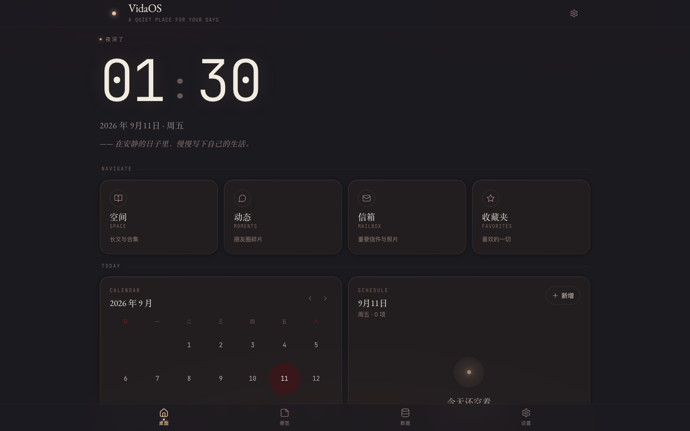
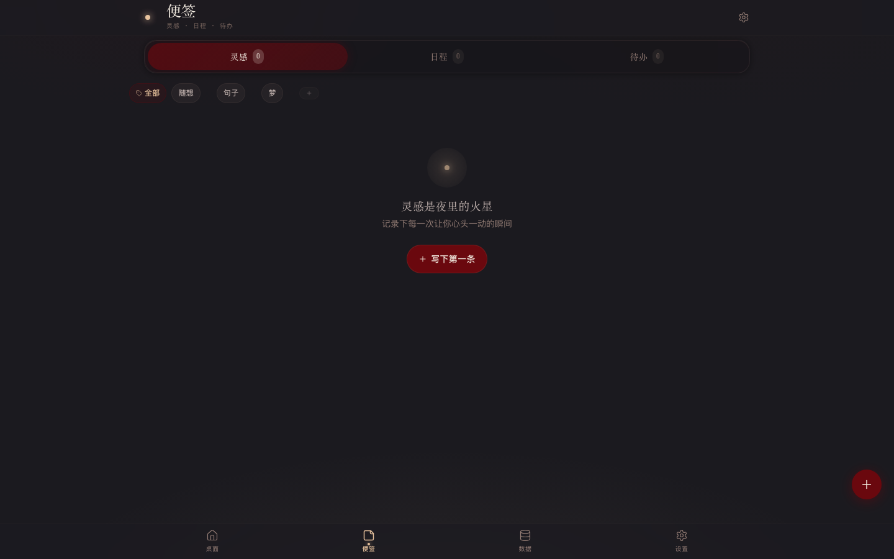
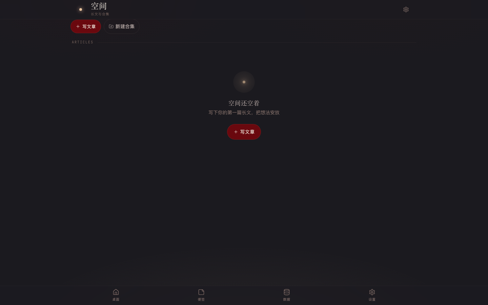
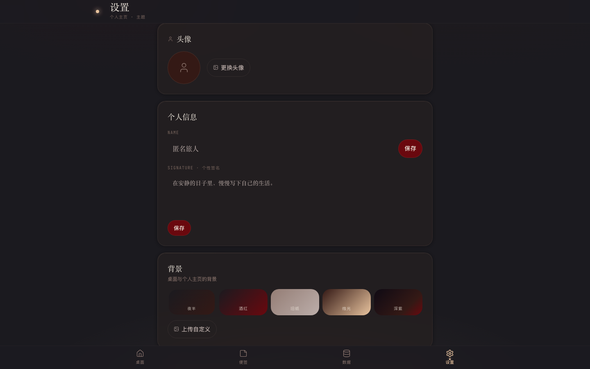
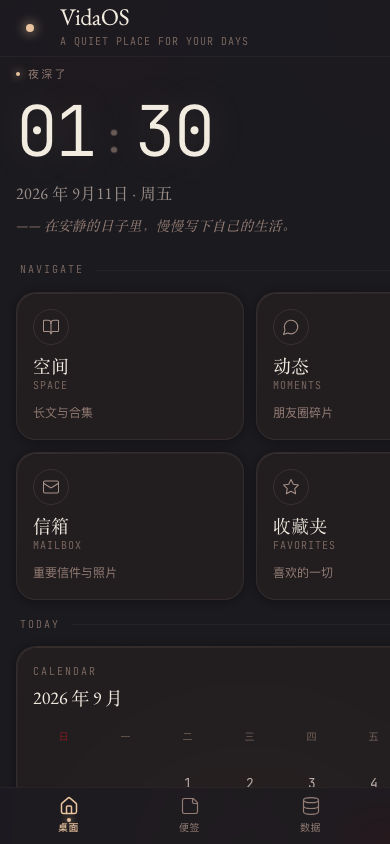

# VidaOS

> 你的私密生活记录空间 —— **暗夜书房**风格，纯本地离线运行，数据完全属于你自己。
>
> v4.4：**馆藏**（书架 + 阅读器：导入 txt/md、划线高亮、引用问 AI 的共读抽屉）上线，
> 取代了原来的「碎片」（**v4.7 碎片以新形态回到「便签」里**：日历 + 当天时间轴，见下）；
> 底栏改为 **主页 / 便签 / Agent / 数据 / 设置**。

  

---

## ✦ 主题与设计语言

### 三种书房主题（设置 → 外观）

| 主题 | 说明 | 键 |
|------|------|----|
| **暗夜书房** | 默认 · 深色羊皮纸风格，长时间阅读友好 | `night` |
| **白昼书房** | 日间浅色主题（晨光米面），跟随系统或手动切换 | `day` |
| **猩红书房** | 独立深色主题（酒红 + 深紫渐变），卡片采用液态玻璃质感 | `scarlet` |

主题选择持久化在 `localStorage`（键 `vidaos-theme`），支持「跟随系统」；
`index.html` 内联脚本在首帧前设置 `data-theme`，避免刷新白屏闪烁。

### 暗夜书房 · 色板（用户亲自选定，**不要擅自改**）

视觉灵感来自私人书房里最安静的时刻——老打字机、陈年波尔多酒、烛光、羊皮纸、旧木桌。
色板在 `tailwind.config.js` 与 `globals.css` 的 `:root` 两处保持一致：

| Token | 色值 | 含义 |
|------|------|------|
| `ink` | `#1B1A1F` | 深夜紫黑 —— 主背景 |
| `charcoal` | `#2A292E` | 炭黑 —— **上层卡片**，比 ink 亮一档做层级 |
| `wood` | `#341915` | 暗咖啡 —— 副背景 |
| `wine` | `#6A080E` | 暗酒红 —— 强调色（克制使用） |
| `wine.bright` | `#8C1117` | 深一档酒红 —— 危险 / 删除 |
| `bronze` | `#947D75` | 古铜枯叶 —— 次要文字、辅助元素 |
| `paper` | `#BCAEAA` | 旧纸米色 —— 主要文字 |
| `candle` | `#E8C39E` | 烛光暖橘 —— 装饰高光 |
| `moon` | `#F2EBE0` | 月光白 —— 大数字、标题 |
| `amber` | `#C9A063` | 陈年琥珀 —— 高亮 / 星标 / 选中 |
| `parchment` | `#D8C3A8` | 旧羊皮 —— 引文 / 代码底色 |
| `ash` | `#8A858C` | 灰雾 —— 禁用 / 元信息 |
| `olive` | `#6E7355` | **语义 · 成功** |
| `sapphire` | `#5C6B8C` | **语义 · 信息** |
| `line` | `#4A3F3C` | 描边 / 分隔线 |

**视觉规则**
- 暗色优先（暗夜/猩红），适合长时间阅读；白昼书房为浅色，供日间与跟随系统使用；
- 大圆角柔和卡片（20–28px），半透深色 + 极细描边 + 内侧烛光高光；
- 宽松行高（正文 1.85x / 阅读 1.95x），大段文字阅读舒适；
- 大号打字机字体呈现时间（`JetBrains Mono`），衬线字体呈现正文（`EB Garamond`）；
- 烛光环境：屏幕底部一抹极淡的暖色光晕渐变；
- 暗酒红 `#6A080E` 只在按钮、链接、标签、选中态使用，绝不滥用；
- 无炫光、无渐变特效、无大阴影（用透明度区分层级）。

**字体组合（全部本地自托管，无 CDN 依赖）**
- 显示/数字：`JetBrains Mono`（打字机风，等宽）
- 正文/标题：`EB Garamond`（衬线，长时间阅读）＋ `Noto Serif SC`（中文衬线，随文章加载）
- UI 元素：`Inter`（无衬线）

**背景与栏色**
背景采用**主题实色**方案（由各主题的 `--bg-base` 兜底），不再提供多套背景预设；
唯一保留的渐变「深紫」仅用于猩红书房（夜间主题 + 无自定义图时自动叠加）。
顶栏/底栏毛玻璃背景跟随 `var(--bar-bg)`，触屏与桌面视觉统一。

---

## ✦ 界面预览

**桌面（首页）** —— 大时钟 Hero + 功能宫格 + 双卡日历/日程 + 音景播放器



| 便签 | 空间 |
|------|------|
|  |  |

| 设置 | 移动端 |
|------|--------|
|  |  |

> 截图取自 v3.0；此后界面有若干调整（信箱移除、底栏曾改为 主页/碎片/Agent/数据/设置、
> v4.4 碎片下线改 主页/便签/Agent/数据/设置、主题系统与馆藏等），见 `PROJECT_MEMORY.md` 变更日志。

---

## ✦ 功能一览

### 桌面（首页）
- **大时间日期标题区**：打字机风大时钟 + 日期 + 问候语 + 个性签名；
- **功能宫格**：空间 / 动态 / 便签 / 收藏夹 四个入口；
- **日历 + 当日日程（双卡）**：月历事项日打点，**点击日期右侧日程会跟着切换**（含「今」按钮回到今天）；
- **待办模块**：展示全部未完成待办，支持快速添加与勾选完成，超出 6 条可一键去便签查看；
- **音景播放器**：内置「夜雨」「烛光」（WebAudio 实时合成）+ 本地音频导入、播放/暂停/上下首/进度/音量；
- **功能宫格**：空间 / 动态 / **馆藏** / 收藏夹；
- **底部 Tab**：主页 / **便签** / Agent / 数据 / 设置（v4.4：便签上位，碎片下线）。

### 图片
- 上传的图片默认压到**长边 2560 / JPEG 0.9**（手机满屏和放大看都够清楚）；
  需要原始分辨率的，在上传处点一下「**存原图**」（会记住选择）——
  原图只用于点开大图与保存，**正文、列表、相册网格仍然加载轻量预览图**，所以不会变卡。
- 小于 500KB 的图片**原样保存**，不做任何压缩。

### 空间
- Markdown 长文 + **合集**分组 + 封面；
- **标签栏目**（合集与文章之间）：自动汇总所有文章用到的标签并显示使用次数，
  **点标签筛选文章**、**双击改名**（所有用到它的文章一起改）、**× 删除**（从所有文章上摘掉，会先确认）；
- 配图可**插入正文**（编辑器缩略图上的「插入正文」按钮会插入 ``），
  也可以留在文章下方；缩略图支持**拖拽排序**（触屏长按拖动）；
- **Obsidian 风格双链**：正文用 `[[文章标题]]`（或 `[[标题|显示文字]]`）链接其它文章，
  点击直接跳转，**目标不存在时自动创建新文章**；文章页底部展示「反向链接」（谁引用了本文）
  与「正向链接」（本文引用了谁）；
- 合集详情页操作按钮横排在标题栏下方。

### 动态
- **时间线**布局：按日期分组（今天 / 昨天 / M 月 D 日）+ 左侧竖线节点；
- 每条显示**头像与昵称**，支持 **Markdown**、多图、**评论**、**收藏**；
- **编辑**：可修改内容与图片，**并可直接修改发布时间**（便于补记过去的事）；
- **查找与替换**：顶部「查找替换」条，命中高亮、上下跳转、替换 / 全部替换。

### 便签（v4.4 起在底栏第三格）
- **碎片 / 灵感 / 日程 / 待办** 四块，顶部滑块切换（**默认落在碎片**）；
- **碎片（v4.7 重新启用）**：上方月历（点日期跳到那天，有碎片的日期带圆点；
  **点标题就能选年 / 月**，应用内弹窗、带取消键），下方是当天的**极简时间轴** ——
  左侧一条竖轨，每个条目一个圆点，圆点与时间同一行、正文在下面；
  右下角加号记一句，**自动记录当下时间**，按天储存。
  输入区有一个时间入口：**今天不动它 = 记在此刻**，补记历史某天时可以点开应用内的
  时间选择器改成当时那一刻（补记时输入区会写明「补记到 X 月 X 日」）。
  条目可就地编辑、可删除（应用内确认弹窗），也支持一个可选的轻量标签。
- **碎片 · 时间胶囊（v4.7.7）**：把碎片**补记到未来**（晚于此刻 5 分钟以上），就种下一颗
  时间胶囊 —— 输入区会预告、提交时提示「种下一颗时间胶囊」，**时间轴下方出现【时间胶囊】栏目**。
  未到开封日的胶囊默认折起来（可点「点开看看」预览），**到了那天它仍然留在栏目里**，
  状态变成「今天开启 / 已开启」并把内容铺开。
- 灵感 / 日程 / 待办：分类筛选 + 增删改（双击标签重命名）；
  **新建时手填的新分类会自动加进上面的标签栏**（v4.7.7）；
- **待办**：「隐藏已完成」的开关在你切到别处再回来时**仍然保持**（v4.7.7）；
- 日程可选日期时间（**时间**走应用内弹窗），**自动同步到首页日历**（主页日程卡可直接编辑/排序）；
- 待办支持**回车=换行**、长按**拖拽排序**、已完成自动置底。

### 音乐
- 导入本地音频，四种播放模式（顺序 / 随机 / 单曲循环 / 播完暂停）；
  **「单曲循环」的语义**：它只让当前这首反复播，点「下一首」会**真的换到下一首**
  （然后由那一首继续循环），不是把本曲从头重来 —— 有些音乐软件是后者，这里是**有意**
  采用前者（点了下一首就该换歌）。播放模式只决定「一首自然放完之后怎么办」，
  上一首 / 下一首永远按歌单顺序走；
- **歌单可拖动排序**：歌单面板右上点「排序」→ 按住歌名上下拖动 → 「取消」还原 /「完成」保存；
  自动续播与上一首/下一首都按歌单顺序走。

### 收藏夹
- 跨类型聚合收藏的空间文章 / 动态，**每条带类型标签**（文章 / 动态）；
  点动态会**精准定位并高亮**到那一条（动态没有独立页面，靠页内定位）。

### 馆藏（v4.4 新增 · 书架 + 阅读器）
- **书架**：从本地导入 **txt / md** 文本即成一本书，卡片显示字数、标注数与阅读进度；
  长标题、进度条、重命名 / 移出书架（应用内 Modal，不用 prompt）。
  单本建议 **5 万字以内**（硬上限 20 万字），导入时超长会提示；
  超长正文会**分批挂载**（首屏先出来、其余在空闲帧补齐），不至于一点开就卡住。
- **阅读器**：连续滚动、自动记住读到哪、回来接着读；md 按 Markdown 渲染
  （标题 / 列表 / 引用 / 加粗都正常），txt 段内换行原样保留。
- **划线 / 高亮**：选中一段（手机长按、桌面拖选）弹出浮动工具条 ——
  **划线 / 高亮 / 复制**；跨段选择会自动拆成多条，各自锚在自己那一段，
  跨行内元素（加粗、软换行 `<br>`、列表项）也能正确上色且**不会破坏段落结构**。
  标注锚点是「块索引 + 块内字符偏移」，重新渲染（换主题、改字号）之后依然准确。
- **书签**：所有划线 / 高亮收在书里右上角的「书签」面板，按正文顺序排列，
  点一条跳到正文并闪烁定位，可逐条删除；标注存在本机，也随备份一起走。
- 阅读进度按「读到第几块」记，**滑到最底部即 100%**；回到中间会跟着回落。
- 想和 AI 聊书里的内容：去 Agent 页贴一段给它（阅读器内置的引用提问入口 v4.4.1 已按要求下线）。

### Agent
- **多会话聊天助手**：会话列表 → 点进 → 聊天的多会话模式，新建会话自动开场白；
- 气泡流界面（布局借鉴独立项目 Ventana 并 React 化，已适配三版书房皮肤）；
  用户酒红气泡、AI 回复非盒子渲染 Markdown、流式输出、消息可复制 / 重新生成 / 删除；
- 既能**整理馆藏与资料**（资料库与藏书按需读取 `[[读:书名]]`、记忆馆 `[[忆:]]`、自动记住
  `[[记:标题]]`），也能**聊生活、学习与事件**；未配置 API 时自动进入演示模式；
- **资料库**：上传 ≤400KB 文本（Markdown / txt）供 Agent 按需读取；
  **记忆馆**：Agent 写入的长期记忆（带未读红点），可展开 / 删除 / 标记已读；
- 会话**归档**抽屉（恢复 / 导出 txt / 删除）；连接配置（Base URL / API Key / 模型）存本机，
  API Key 不随 WebDAV 备份上传；全部数据本地 IndexedDB。

### 数据
- **导出**：JSON（图片内嵌 Base64，可完整恢复）/ TXT / Markdown / PDF；
  **导出范围可多选**：空间文章 / 动态 / 便签（灵感 + 日程 + 待办 + 碎片）/ 收藏夹 / 个人资料；
- **PDF**：米色羊皮纸衬线排版、内嵌配图、居中页码（`· n ·`）；分页切点在渲染画布上
  像素扫描行间空白带，**不会把一行字切成两页**，末页内容不足时垂直居中；
- **本地文件夹快照备份**：选一个本地文件夹，一键保存当前全部数据的快照；
  **最多保留 10 份，超出自动删除最早的一份**；手动导出的文件不占用快照额度；
  文字用 gzip 压缩、图片按原样存放（不做 Base64，省约 33% 体积）；
- **WebDAV 全量备份**：一键把全部数据（含图片音频）上传到你的 WebDAV 空间
  （坚果云等），可**开启端到端加密**（PBKDF2 + AES-256-GCM，口令只在本机）。
  **云端保留最近 5 份**：最新一份固定覆盖，上一份在同步前自动改名归档，超出份数自动清理；
  点「云端历史」可查看各份（时间 / 大小）并**恢复指定的某一份**——
  所以删掉的内容虽然不在最新备份里了，但更早的份里还留着，可以从那里找回来
  （被挤出 5 份窗口的旧版本会被清理，删掉不可恢复）。
  服务端不支持列目录/改名（PROPFIND/MOVE）时，会自动退回「只保留最新一份」并如实提示。
  WebDAV 区块下方有**「备份配置说明书」**弹窗（配置教程 / 失败原因详解 / 加密说明 / 重要提醒）；
- **导入**：JSON 备份（合并 / 覆盖）、Markdown（按 `#` 分篇）、TXT；
- 顶栏云同步图标：未配置 WebDAV 时点击跳转到数据页并提示。

### 设置
- 头像（压缩到 512px）、昵称、个性签名；
- **外观**：三张主题卡（跟随系统 / 日间·白昼书房 / 夜间·暗夜书房）+ 猩红书房方案卡
  （独立主题，卡片呈液态玻璃质感，光效锚点固定、不跟随鼠标）；
- 关于（版本信息）。

### 全局
- **查找替换**：桌面/移动通用全屏覆盖层（顶栏放大镜或 **⌘K**），命中高亮 + 跳转定位闪
  烁 + 替换 / 全选 / 反选；空间文章 / 动态页另有页内查找条；
- 两层错误边界（渲染出错不白屏）、PWA 离线可用、响应式适配、`prefers-reduced-motion`、
  安全区适配、夸克等旧内核兼容（ES5 legacy bundle + 挂载兜底提示）。

---

## ✦ 编辑器（核心）

全屏沉浸式 Markdown 编辑器：

- **丝滑输入** —— 原生 `textarea`，`caret-color` 烛光橘、1.95 倍行距、宽松留白，中文输入法无卡顿；
- **Markdown 工具栏**（加粗 / 斜体 / 标题 / 列表 / 引用 / 代码 / 链接 / 图片 / 分割线）；
- **双链按钮**：工具栏「双链」可弹出文章选择器，快速插入 `[[文章标题]]`（移动端直接插入占位）；
- **写作 / 预览切换**，预览用 `marked + DOMPurify` 净化渲染；
- **图片附件**：多选上传，>500KB 自动压缩到 1600px / 0.82 质量；
- **插入正文**：把配图插到光标位置（`fileRef:` 语法），插入后缩略图带标记；
- **拖拽排序**：直接拖动缩略图调整图片顺序（触屏长按进入排序）；
- **字数统计**（排除 Markdown 标记）；
- **收藏星标**（编辑已有文章时可直接收藏）；
- 标签与合集归属（仅文章）；动态可修改发布时间。
- 移动端：底部大按钮 + 浮动格式条，保存按钮「保存」。

---

## ✦ 开始使用

### 最省事的方式：双击 `打开VidaOS.command`

直接双击项目根目录下的 **`打开VidaOS.command`** —— 它会自动检查依赖、启动服务并打开浏览器。
保持那个终端窗口开着就能一直用，关掉窗口服务就停了。

> ⚠️ 不要双击 `index.html`。它是 Vite 的入口模板（引用的是 `src/main.tsx` 源码），
> 用 `file://` 打开必然白屏，必须经由 HTTP 服务访问。

### 前置要求
- Node.js ≥ 18
- 现代浏览器（Chrome 90+ / Safari 14+ / Edge 90+）；夸克等国产旧内核已做兼容兜底

### 1. 安装依赖

```bash
cd "/Users/amarisgo/Documents/DeepSeek Harness/VidaOS"
npm install
```

### 2. 开发模式

```bash
npm run dev
```

打开 http://localhost:5173 即可看到。开发模式下 Service Worker 默认不注册。

手机预览：与电脑连同一 Wi-Fi，访问终端里打印的 `Network:` 地址（形如 `http://192.168.x.x:5173`）。

### 3. 构建生产版本

```bash
npm run build
```

产物在 `dist/`，可部署到任何静态托管。

### 4. 预览生产版本

```bash
npm run preview
```

打开 http://localhost:4173 ，Service Worker 已注册，可测试 PWA 安装。

### 5. PWA 部署

把 `dist/` 整个目录上传到任意静态托管：

- **Vercel**：`vercel --prod`
- **Netlify**：拖拽 `dist/` 到 dashboard
- **GitHub Pages**：`dist/` 推到 `gh-pages` 分支
- **Cloudflare Pages**：`wrangler pages deploy dist`
- **自建服务器**：Nginx 配置 root 指到 `dist/`

部署后用 Chrome / Edge 打开站点，地址栏右侧会出现「安装」图标，可安装为独立应用。

### 6. iOS Safari 安装

用 Safari 打开部署后的 URL，点底部分享按钮 → **添加到主屏幕**。会作为独立应用运行，全屏沉浸式。

---

## ✦ 数据与隐私

- 全部数据保存在浏览器本地 **IndexedDB** 中（库名 `vidaos`，表 `state` / `files` / `meta`），
  不上传任何服务器；
- 图片 / 音频以 Blob 存储，导出 JSON 时自动内嵌为 Base64；
- **无追踪、无分析、无广告**，完全离线可用；
- 三种备份方式：
  1. **WebDAV 云同步**（可选端到端加密）：上传 gzip 快照到你的坚果云等 WebDAV 空间，
     最新一份固定文件名 `vidaos-backup.json.gz`；开启加密后使用
     **PBKDF2（15 万次迭代）派生 AES-256-GCM 密钥**，口令只存本机、绝不上传，
     **丢失口令 = 永久无法解密**；
  2. **本地文件夹快照**（推荐）：在「数据」页选定一个文件夹，一键保存，最多保留 10 份；
     文字经过 gzip 压缩、图片按原样存放，体积最小；
  3. **手动导出**：JSON 全量备份下载到本地或云盘，不计入快照额度；
- 清理浏览器缓存或换浏览器时，先备份再导入。
- ⚠️ 备注：纯浏览器直连坚果云会被 **CORS 拦截**（坚果云未开放跨域头），代码已就绪，
  Tauri 桌面壳（规划中）落地后自动解除；当前可直接用的云端路径是支持 CORS 的 WebDAV 服务。

---

## ✦ 项目结构

```
VidaOS/
├── 打开VidaOS.command           # 双击即启动服务并打开浏览器
├── index.html                   # Vite 入口（内联主题防闪烁脚本 + 夸克挂载兜底，勿双击）
├── src/                         # 56 个文件
│   ├── main.tsx                 # 入口：错误边界 > initTheme > HashRouter > App
│   ├── App.tsx                  # 全局布局 + 路由 + tab 同步 + 两层错误边界
│   ├── styles/globals.css       # 设计 token + 三主题变量 + Markdown 排版
│   ├── types/index.ts           # 数据类型定义（v4：TabKey 含 diary/agent）
│   ├── lib/
│   │   ├── db.ts                # Dexie（state / files / meta）+ 旧数据迁移
│   │   ├── theme.ts             # 主题：暗夜/白昼/猩红（localStorage 持久化）
│   │   ├── backgrounds.ts       # 背景预设（无 / 深紫·猩红专属）
│   │   ├── fileUrl.ts           # Blob → objectURL 缓存
│   │   ├── markdown.ts          # marked + DOMPurify（支持 fileRef:）
│   │   ├── exportImport.ts      # JSON / TXT / MD / PDF 导入导出（像素级分页切点）
│   │   ├── snapshot.ts          # 本地文件夹快照备份（≤10 份）
│   │   ├── webdav.ts            # WebDAV 云同步 + 端到端加密（AES-256-GCM）
│   │   ├── library.ts            # ★ 馆藏：正文切块 + 划线锚点数学（块索引 + 块内偏移）
│   │   ├── agentTurn.ts          # ★ 一轮 Agent 回复（会话页与共读抽屉共用）
│   │   ├── focusRequest.ts      # 查找跳转定位机制
│   │   └── utils.ts             # 时间 / ID / 压缩 / 文本工具
│   ├── stores/                  # useAppStore / useUIStore / useMusicStore
│   ├── components/
│   │   ├── layout/              # Background / TopBar / BottomTabBar
│   │   ├── home/                # ClockHeader / FeatureGrid / CalendarCard / DayScheduleCard / MusicPlayerCard
│   │   ├── notes/               # SegmentedControl / CategoryChips / Inspiration / Schedule / Todo / ScheduleEditor
│   │   ├── editor/              # MarkdownEditor / EditorOverlay
│   │   ├── search/              # GlobalFindReplaceCard / PageFindBar / usePageFind
│   │   └── common/              # Card / Button / Tag / Toast / Modal / EmptyState / MediaImage
│   │                            #   + ErrorBoundary / MarkdownView
│   ├── components/library/      # ★ CoreadDrawer（阅读器「共读」抽屉）
│   └── pages/                   # 12 个路由页面（Library 书架 / Reader 阅读器 / Agent 等）
├── public/                      # favicon + PWA 图标
├── scripts/make-icons.mjs       # 生成 PWA 图标（需自行安装 sharp）
├── docs/                        # 界面预览截图 + 色板依据
├── PROJECT_MEMORY.md            # 项目记忆与交接文档（改代码前请先读它）
└── 配置文件：vite.config.ts / tailwind.config.js / postcss.config.js / tsconfig.json
```

> V2.1 旧应用（原生 HTML/CSS/JS 版本）已不在工作区，但永久保留在 git 历史里：
> `git checkout 4377d94 -- archive/v2` 即可取回。

---

## ✦ 技术栈

| 技术 | 用途 |
|------|------|
| Vite 5 | 构建工具（dev server、build；dev 也转译到 es2018 兼容旧内核） |
| React 18 + TypeScript | UI 框架 + 类型系统（strict + noUnusedLocals） |
| TailwindCSS 3 | 样式系统（设计 token 化） |
| Zustand | 轻量状态管理 |
| React Router 6 | Hash 路由 |
| Dexie 4 | IndexedDB 友好包装 |
| marked + DOMPurify | Markdown 渲染 + HTML 净化 |
| jsPDF + html2canvas | PDF 导出（米色衬线排版 + 内嵌图片 + 居中页码 + 像素级切点） |
| @fontsource（EB Garamond / Inter / JetBrains Mono / Noto Serif SC） | 自托管字体，无 CDN |
| lucide-react | 细线线性图标库 |
| @vitejs/plugin-legacy | 旧内核 ES5 legacy bundle（夸克等） |
| vite-plugin-pwa | Service Worker + manifest 生成（autoUpdate） |

---

## ✦ 键盘与可访问性

- 键盘聚焦：按钮、链接、输入框支持 Tab 焦点；
- 焦点环：酒红 / 烛光色 2px outline；
- 减少动效：尊重 `prefers-reduced-motion`；
- 安全区：移动端 `env(safe-area-inset-*)` 适配；
- IME：textarea 中文输入法无卡顿；
- **全局查找**：`⌘K`（macOS）/ `Ctrl+K` 唤起，覆盖空间 / 动态 / 灵感三个范围，支持替换；
- **错误边界**：渲染出错不再白屏，而是给出「重试 / 回到桌面 / 重新加载 / 复制错误详情」。

---

## ✦ 已知限制

1. 浏览器本地隔离：不同浏览器 / 设备之间需手动「导出 → 导入」或 WebDAV 云端备份同步；
2. **WebDAV 云端同步受 CORS 限制**：纯浏览器直连坚果云会被拦截（坚果云未开放跨域头），
   Tauri 壳落地后自动解除；多设备同时编辑同一备份会互相覆盖，请勿同时在多端编辑；
3. PDF 通过 `html2canvas + jsPDF` 生成（整篇渲成一张长图再按页切片），
   分页切点会避开文字行，因此不会把一行字切成两页；但**当下一块是接近整页高的图片时，
   上一页可能提前收尾、留出较多空白**；
4. 本地文件夹快照需要浏览器支持 File System Access API（Chrome / Edge）；
   Safari / Firefox 下请改用 JSON 导出或 WebDAV 云端备份；
5. 浏览器存储配额约 50MB–数 GB（视浏览器而异），大量图片时请定期清理或导出后清空；
6. 夸克等旧内核需关闭「云加速 / 智能转码」才能正常渲染（页面会给出兜底提示）；
7. Agent 依赖外部对话 API（用户自填 Base URL / API Key / 模型）；未配置时自动进入演示模式，功能可体验但不调用真实模型；
8. **馆藏**：单本建议 5 万字以内（20 万字为硬上限；超长会分批挂载，手机上仍可能偏慢）；跨段选择会拆成多条标注；
   阅读器内已屏蔽浏览器原生右键/长按菜单（`contextmenu` + `-webkit-touch-callout`），
   但**真机（iOS/安卓）手势未经复测**；

---

## ✦ 致谢与许可

- 本项目是个人项目，仅供个人使用；
- 字体：`EB Garamond` / `JetBrains Mono` / `Inter` / `Noto Serif SC`（自托管 woff2）遵循 OFL 协议；
- 图标：lucide-react 遵循 ISC 协议；
- 其他依赖遵循各自开源协议；
- V2.x 曾借鉴 [InternalBeyond-Mobile](https://github.com/Sui-IB/InternalBeyond-Mobile)
  （PolyForm Noncommercial 1.0.0），V3 起完全自研。

---

**记录生活的每一刻，让回忆有迹可循。**