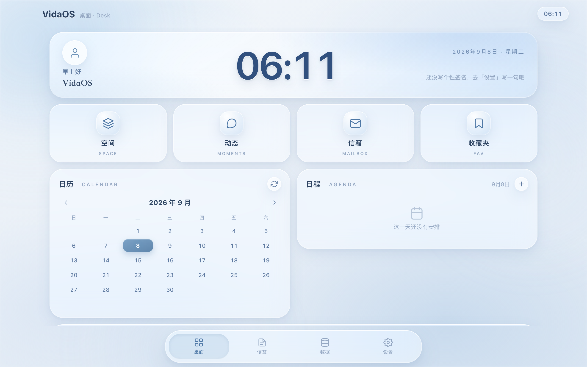

# VidaOS

> 你的私密生活记录空间 —— iOS 原生**液态玻璃（Liquid Glass）**风格，纯本地离线运行，数据完全属于你自己。



VidaOS 是一个面向个人的本地博客 / 生活记录系统。它不依赖任何服务器，所有数据都保存在浏览器的本地存储（IndexedDB）里，让你安心记录生活、上传照片、写下吐槽与长文，而不必发到社交网络。

---

## ✦ 设计语言：液态玻璃

整套界面遵循 **iOS Liquid Glass（液态玻璃 / 轻量新拟态 + 磨砂玻璃拟态）** 的语言：

- **没有实线边框** —— 组件之间靠柔和内外阴影 + 留白区分，绝不画硬边框（玻璃边缘以 1px 白色内阴影高光线模拟）；
- **半透磨砂** —— 卡片 `background: rgba(255,255,255,0.44~0.68)` + `backdrop-filter: blur(24px) saturate(160%)`；
- **大圆角** —— 卡片 28–30px、按钮胶囊形；
- **柔和弥散阴影** —— 外侧浮起投影 + 内侧高光 `inset`，模拟玻璃受光；
- **低饱和灰蓝配色** —— 正文 `#2E4462`、次要 `#5F7AA0`、强调雾霾蓝 `#6E93B8`，无纯黑、无鲜艳色；
- **12 列挂件网格** —— 首页卡片按 `dk-full / dk-6 / dk-3` 跨度自动排布（参考 InternalBeyond 的 Desk 体系），移动端竖排、桌面端并排，避免左右失衡与元素挤压；
- **浮雕大数字** —— 首页大时钟用多层 `text-shadow` 做出柔和浮雕，无厚重描边。

---

## ✦ 功能一览

### 桌面（首页）
- **大时间日期标题区**：问候语 + 浮雕大时钟 + 日期 + 个性签名 + 头像；
- **网格功能图标**：空间 / 动态 / 信箱 / 收藏夹 四个入口（中文 + 英文标签、细线线性图标）；
- **日历卡片**（双卡式）：月历 + 当日日程面板，事项日打点，点日期即显示当天日程；
- **音乐播放器卡片**：液态玻璃唱片 + 玻璃滑块 + 圆形控件，内置「雨声·白噪音」音景，也可导入本地音频；
- **底部 Tab 导航**：桌面 / 便签 / 数据 / 设置。

### 空间
- 长文创作空间，支持 **Markdown** 与**合集**（分组整理文章）；
- 新建 / 编辑 / 删除文章与合集，可带图发布、打标签、设封面（取首图）。

### 动态
- 朋友圈式的短内容存放地，可带多图发布。

### 信箱
- 存放重要信件与照片，火漆印章未读提示。

### 收藏夹
- 收藏空间文章 / 动态 / 信件，统一查看。

### 便签
- **灵感 / 日程 / 待办** 三块，顶部导航下带**分区滑块**；
- 可分别设置分类（筛选 + 管理），支持添加、编辑、删除；
- 日程可选日期与时间，并自动同步到首页日历。

### 数据
- **本地持久化**（IndexedDB，图片 / 音频以 Blob 存储，不占满配额）；
- **导出**：JSON / TXT / Markdown / PDF（PDF 排版美观），**可选择备份范围**；
- **导入**：JSON 备份（合并 / 覆盖）、Markdown、TXT。

### 设置
- 个人主页：头像、背景（预设渐变 / 自定义图）、个性签名、昵称。

---

## ✦ 编辑器（核心）

全屏沉浸式 Markdown 编辑器：

- 丝滑输入 —— 原生 `textarea`，`caret-color` 雾霾蓝、1.85 倍行距、宽松留白，中文输入法（IME）无卡顿；
- Markdown 工具栏（加粗 / 斜体 / 标题 / 列表 / 引用 / 代码 / 链接 / 图片 / 分割线）；
- 写作 / 预览切换，实时渲染（marked + DOMPurify 净化）；
- 图片附件拖带预览、字数统计。

---

## ✦ 开始使用

### 方法一：直接打开

克隆或下载本项目，用现代浏览器打开 `index.html`：

```bash
cd VidaOS
open index.html          # macOS
# 或 Windows 双击 index.html
```

### 方法二：本地服务器（推荐，体验完整 PWA）

```bash
cd VidaOS
python3 -m http.server 8080
# 或 npx serve .
```

访问 `http://localhost:8080`。

### 方法三：PWA 部署

把整个目录上传到任意静态托管（GitHub Pages / Vercel / Netlify / 你自己的服务器）即可。已内置 `manifest.webmanifest` 与 `sw.js`，支持：

- 添加到主屏幕 / 安装为独立应用；
- 离线缓存运行；
- 全屏沉浸体验。

---

## ✦ 数据与隐私

- 全部数据保存在本地 **IndexedDB**，不上传任何服务器；
- 图片 / 音频以 Blob 存储，导出备份时自动内嵌为 Base64；
- 无追踪、无分析、无广告，完全离线可用；
- 请定期「数据 → 导出备份」，避免清理浏览器缓存导致数据丢失。

---

## ✦ 项目结构

```
VidaOS/
├── index.html            # 应用骨架
├── css/style.css         # Liquid Glass 设计系统 + 全部样式
├── js/
│   ├── app.js            # 应用逻辑（路由/首页/日历/音乐/便签/编辑器/导入导出）
│   ├── store.js          # 数据层（IndexedDB + localStorage 回退）
│   ├── icons.js          # 细线线性图标库
│   └── vendor/           # 本地化的 marked.js / DOMPurify
├── manifest.webmanifest  # PWA 清单
├── sw.js                 # Service Worker（离线缓存）
├── assets/               # 图标（SVG + PNG）
└── docs/                 # 预览截图
```

---

## ✦ 技术栈

| 技术 | 用途 |
|------|------|
| HTML5 / CSS3 | 结构 + 液态玻璃样式 + 响应式 |
| Vanilla JS (ES2020+) | 应用逻辑、状态管理 |
| IndexedDB | 本地数据 + Blob 媒体存储 |
| marked.js | Markdown 渲染（本地化） |
| DOMPurify | 内容安全净化（本地化） |
| Service Worker | PWA 离线缓存 |

---

## ✦ 致谢与第三方声明

VidaOS 的首页桌面与液态玻璃视觉，**参考并改编了 Sui-IB 的开源项目 [InternalBeyond-Mobile](https://github.com/Sui-IB/InternalBeyond-Mobile)**（移动端）与 **InternalBeyond 桌面版**（仅作排版对照）。具体借鉴程度如实说明如下：

**改编使用了（代码层面，均已改写适配）：**

1. **12 列 CSS Grid 挂件墙** —— 本项目的 `.dgrid / dk-full / dk-6 / dk-3` 跨度体系，改编自 IB 的 `sb-desk` 12 列网格与其 `dk-*` 跨度方案；
2. **玻璃材质口径** —— 半透 0.4 级玻璃 + `blur(24px) saturate(160%)` + 1px 白色内阴影高光线（模拟玻璃边缘，非实线边框）；
3. **月历 / 日程挂件与大时钟 Hero 的信息层级** —— 参考 IB Desk 首页的组成方式，重新设计与适配。

**未使用的：** Sui-IB 的 AI / 社交 / 通话 / 影音功能与数据格式；其生成的背景与插画素材。VidaOS 的便签、编辑器、导入导出、PWA 等业务功能均为本项目独立编写；桌面端网页适配（宽屏看板、横版 Hero、底部 Dock）为本项目自行完成。

> **许可合规**：InternalBeyond 代码采用 **PolyForm Noncommercial License 1.0.0**。VidaOS 仅供个人 / 非商业使用；本仓库附有 `THIRD_PARTY_NOTICES.md`（含 Required Notice 与许可链接），任何分发请一并保留。若日后需要商业使用，请联系 Sui 取得书面授权。

感谢 [Sui-IB](https://github.com/Sui-IB) 的开源分享。如果你喜欢更强大的 AI 社交与影音能力，可以去看看原项目。

---

## ✦ 已知限制

1. 数据浏览器本地隔离，不同浏览器 / 设备之间需手动「导出 → 导入」同步；
2. 无多用户、无加密存储（敏感内容请自行斟酌）；
3. PDF 导出通过浏览器打印对话框完成，需在打印界面选择「另存为 PDF」。

---

**记录生活的每一刻，让回忆有迹可循。**
